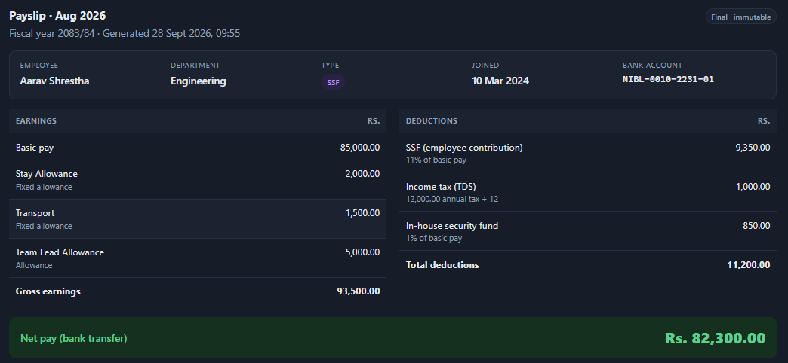
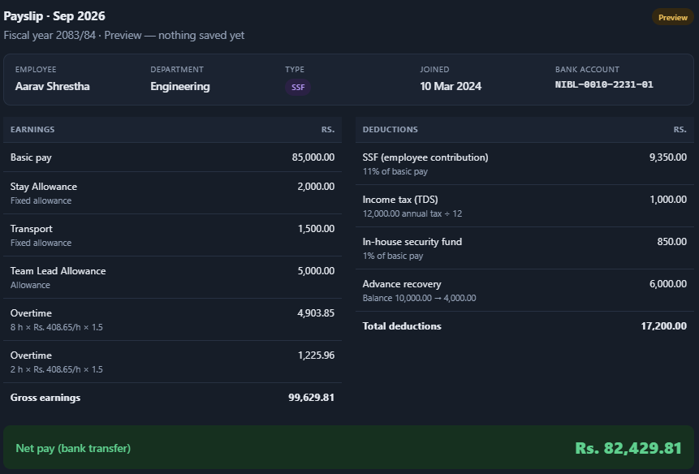
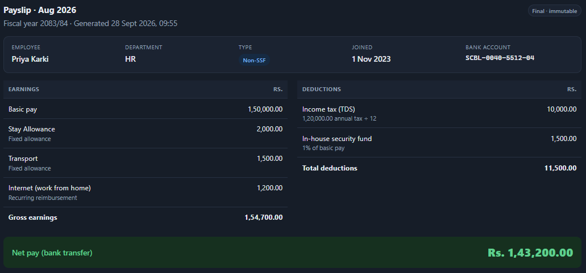

# Nepal Payroll System

A small end-to-end payroll app: employee records, a payroll calculation engine and
monthly payslips. It has an **Admin** view and a read-only **Employee** view.

**Stack:** Node.js + Express, PostgreSQL (plain SQL with `pg`), React + Vite.

## Features

**Employees**
- Add, edit and remove employees (SSF or Non-SSF). Removal is a soft delete, so old payslips stay viewable.
- Filter employees and payslips by SSF / Non-SSF.

**Configuration (per fiscal year)**
- Fiscal years as AD date ranges (seeded: 2083/84 = 2026-07-17 to 2027-07-16).
- SSF rates (employee 11%, employer 20%), progressive income tax slabs and in-house security fund %.
- Fixed allowances that apply to every employee every month.

**Per-employee items**
- Dynamic allowances (paid every month until removed)
- Overtime entries for the current month: `hours × (basic_pay / 208) × multiplier`
- One-time and recurring reimbursements
- Advance with monthly installments (one per employee per fiscal year)
- Secret salary (internal cost tracking only, never paid and never shown in the Employee view)

**Payroll**
- Preview a payslip, then generate it. Each payslip stores a full snapshot and can't be changed or deleted.
- Payslips are generated month by month in order, with no skipping and no future months.
- A payroll run page generates every ready payslip for a month in one go.
- An admin cost report shows net pay + employer SSF + secret salary per employee.

**Calculation**
- Gross = basic pay + fixed and dynamic allowances + overtime + reimbursements
- Deductions = SSF employee share (SSF employees only) + income tax + security fund + advance installment
- Income tax: `basic_pay × 12` is taxed with the slabs, and the result is divided by 12
- Net pay = gross − deductions


## Requirements

- Node.js 20.19+ (or 22.12+)
- PostgreSQL 14+ running locally 

## Setup

### 1. Configure the database connection

Copy `backend/.env.example` to `backend/.env`:

```bash
cp backend/.env.example backend/.env        # Windows: copy backend\.env.example backend\.env
```

Then put your PostgreSQL details in it:

```env
DB_HOST=localhost
DB_PORT=5432
DB_USER=postgres
DB_PASSWORD=your_password
DB_NAME=nepal_payroll
PORT=4000
```

That's the only file you need to edit. You don't have to create the database yourself.
On first start the backend creates `DB_NAME`, builds the tables and loads the sample data.

### 2. Run the backend

```bash
cd backend
npm install
npm run dev
```

The first run prints:

```
Created database "nepal_payroll"
  applied db/schema.sql
  applied db/seed.sql
Database "nepal_payroll" is ready
Payroll API listening on http://localhost:4000
```

Later runs skip straight to starting the API.

### 3. Run the frontend (in a second terminal)

```bash
cd frontend
npm install
npm run dev
```

Open http://localhost:5173. The frontend sends API calls to the backend on the `PORT` from `backend/.env`.

Use the **View as** switch in the top bar to change between **Admin** and **Employee view**.

## Useful commands (run inside `backend/`)

| Command | What it does |
|---|---|
| `npm run dev` | Start the API with auto-reload (sets up the database if needed) |
| `npm start` | Start the API without auto-reload |
| `npm run db:reset` | Delete all data and reload the schema and sample data |
| `npm run db:setup` | Create and seed the database without starting the API |

## Sample data

The seed loads fiscal year 2083/84 with its rates, two fixed allowances (Stay Allowance
2,000 and Transport 1,500) and 5 sample employees. Some of the samples come with a dynamic
allowance, a recurring reimbursement, an advance, a one-time reimbursement or a secret
salary, so every feature has something to show.

## Roles

There is no login. The frontend sends the selected role in an `x-role` header (`admin` or `employee`).

- **Admin:** full access, including generating payslips, secret salary and the cost report.
- **Employee view:** read-only. The server removes secret salary and employer cost from every
  response and rejects all changes.

## Project structure

```
backend/
  .env.example        copy to .env and edit
  db/schema.sql       tables, constraints and payslip triggers
  db/seed.sql         sample rates, allowances and employees
  src/db/setup.js     creates and seeds the database on startup
  src/routes/         API routes 
  src/services/       payroll calculations 
frontend/
  src/admin/          admin pages
  src/employee-view/  read-only pages
  src/shared/         API client, role switcher, payslip view
```

## Payroll rules

| Rule | Behaviour |
|---|---|
| Which fiscal year a month belongs to | The one containing the month's last day (2083/84 = Jul 2026 to Jun 2027) |
| First payslip month | The later of the joining month and the first fiscal year's first month |
| Dynamic allowance | Pays from the month **after** it's assigned |
| Recurring reimbursement | Pays from the month it starts |
| Stopping / revoking an item | Takes effect from the month of the stop date |
| Overtime | Can only be added for the current month |
| Removing a fixed allowance | Deactivates it (history is kept) |
| Inactive employees | Kept on record, but no payslips until reactivated |

## Troubleshooting

- **`password authentication failed`**: check `DB_USER` / `DB_PASSWORD` in `backend/.env`.
- **`permission denied to create database`**: create the database yourself (`createdb nepal_payroll`)
  or use a user that can create databases. The tables are still set up automatically.
- **Frontend shows network errors**: make sure the backend is running and `PORT` in `backend/.env` matches it.
- **Start over with fresh data**: run `npm run db:reset` in `backend/`.

## Sample payslips

**SSF employee, generated payslip:** SSF employee share (11%), income tax and security fund are deducted.



**SSF employee, preview before generating:** includes overtime entries and an advance installment.



**Non-SSF employee, generated payslip:** no SSF deduction; includes a recurring reimbursement.



